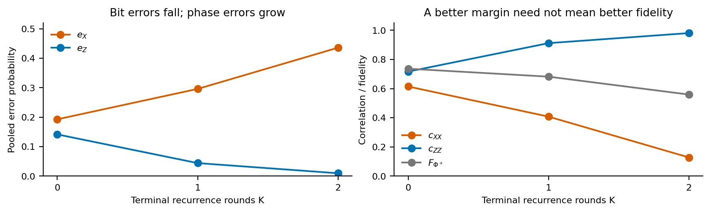
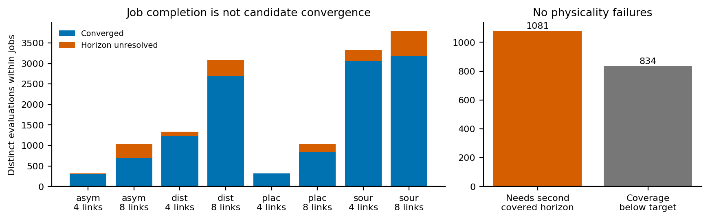

**All 144 jobs completed, but no converged candidate produced positive
secret-key rate on this hardware grid.** This is a negative result for the
specified pooled X/Z BB84 objective and protocol family. It does not establish
that the states are unentangled, that secret key is impossible with other
processing, or that postselection cannot help outside this grid.

The useful findings concern *why* the searches fail. Recurrence can reduce
bit errors while destroying transverse correlations. Under AD, source
imbalance and Phi selection can make the signed key expression almost zero
by producing an almost classical state. Neither effect delivers key here.
Level-versus-node rate comparisons are inconclusive when both rates are
zero, particularly with unresolved schedules.

The earlier positive-rate ideal-hardware findings are preserved in
[the original report](pauliAD-ideal-hardware-report.md), with their original
figures and evidence. They are compared with the new results below.

## What was actually run

The batch in `results/pauliAD/hardware-followup/` ran from **28 October,
22:57 to 29 October, 09:03 CET**, about **10 h 6 min**, using two workers.
Summed subprocess elapsed time was 20 h 11 min; this is not CPU time.
No job failed or timed out.

| Quantity | Observed |
|---|---:|
| Completed jobs | 144 / 144 |
| Trial requests, including cached repeats | 18,696 |
| Distinct candidate evaluations, summed within each job | 14,259 |
| Converged evaluations | 12,344 (86.6%) |
| Horizon-unresolved evaluations | 1,915 (13.4%) |
| Physicality/evaluation failures | 0 |
| Reported stage winners | 336; all SKF = SKR = 0 |

The distinct-evaluation count is **not** a count of globally different
physical experiments: different jobs can evaluate the same candidate.
There was one optimizer seed, 7. Bayesian searches used 60 proposals per
stage plus anchors and matched controls; they are best-found searches,
not certificates of global optimality.

### Hardware, source states and objective

Only scenario **C** was run; D and the historical coherence-time profile
were not included. C takes $p_{\rm gen}=0.00092$, $p_{\rm swap}=0.85$ and
visibility $v=0.96$ from `src/scripts/reproduce_results.py`.
We adopt a 50 km elementary link and propagation speed $2\times10^8$ m/s,
giving a **250-microsecond slot**. This is a hybrid hardware-informed
benchmark, rather than a calibrated model of one device.

[Bradley et al. (2022)](https://doi.org/10.1038/s41534-022-00637-w)
report effective longitudinal and transverse nuclear-memory decay during
network operations of approximately 2.4 s and 1.71 s after charge/resonance
conditioning. We use these as reference $T_1,T_2$. The checks and their
rejection overhead are not simulated, so this is an optimistic reference.
A common scale $s$ multiplies both lifetimes:

| $s$ | $T_1$ (s) | $T_2$ (s) | $T_1$ (slots) | $T_2$ (slots) |
|---:|---:|---:|---:|---:|
| 0.5 | 1.20 | 0.855 | 4,800 | 3,420 |
| 1 | 2.40 | 1.710 | 9,600 | 6,840 |
| 2 | 4.80 | 3.420 | 19,200 | 13,680 |

Two waiting-memory models use these lifetimes. **AD** assumes relaxation
toward $|0\rangle$, with

$$
\kappa=1/T_1,\qquad
\Gamma_X=\Gamma_Y=1/T_2-1/(2T_1),\qquad \Gamma_Z=0.
$$

**Unital** is an unbiased-relaxation control: zero AD and Pauli mode-decay
rates $(1/T_2,1/T_2,1/T_1)$. Measured lifetimes do not identify the
relaxation fixed point; ground-state AD is an additional assumption.
Both models have transverse decay $e^{-t/T_2}$, but only AD creates a
ground-state bias from an initially maximally mixed marginal.

All elementary sources share
$|\psi_q\rangle=\sqrt{1-q}|00\rangle+\sqrt q|11\rangle$.
Bell means $q=1/2$; fixed PE means $q=1/4$.

| Delivery model | Delivered Bell-source state | Initial $\Phi^+$ fidelity |
|---|---|---:|
| Perfect | $|\Phi^+\rangle\langle\Phi^+|$ | 1 |
| Benchmark mixed | $0.96|\Phi^+\rangle\langle\Phi^+|+0.04I/4$ | 0.970 |
| AD 5% | Independent AD probability 0.05 per source qubit | 0.95125 |
| AD 15% | Independent AD probability 0.15 per source qubit | 0.86125 |

Source damping is an input imperfection at delivery, not an extra timed
storage step. Preparation cost and success probability are independent of
$q$. Variable-q mixed sources have the same visibility, not the same Bell
fidelity.

The networks have **four/eight elementary links**, hence five/nine nodes.
With the adopted link length these span 200/400 km.
Placement fixes a balanced tree without distillation. Protocol searches vary
the tree and allow at most two recurrence rounds per vertex and two in total;
their swap acceptance is uniform. Gates are instantaneous and free of
infidelity. Recurrence has its state-dependent success probability but no
extra hardware failure. Swap failures, rejected Bell outcomes, copy
preparation and retries contribute to waiting time. There are no cutoffs,
classical delays, finite-key effects or memory-count normalization.

The objective is

$$
m=1-h_2(e_X)-h_2(e_Z),\qquad
\mathrm{SKF}=\max(0,m),\qquad
\mathrm{SKR}=\frac{\mathrm{SKF}}{\mathbb E[T]},
$$

using the **pooled delivered state**:
$e_X=(1-c_{XX})/2$, $e_Z=(1-c_{ZZ})/2$.
Below, $m$ is the *signed margin*, a diagnostic rather than SKF or SKR.
Every converged margin was negative. Percentage SKR gains therefore have
a zero denominator: they are undefined, not 0% or evidence of equivalent
protocol performance.

### Why this is substantially noisier than the original experiment

One elementary link takes on average $1/p_{\rm gen}=1086.96$ slots,
or 0.272 s, to generate. For two independent geometric generation times,

$$
\mathbb E|G_1-G_2|
=\frac{2(1-p_{\rm gen})}{p_{\rm gen}(2-p_{\rm gen})}
=1086.46\ \text{slots}.
$$

Even the first swap exposes an older pair to appreciable waiting noise;
higher levels and failures add further waiting. At a fixed waiting duration,
two local transverse channels attenuate $c_{XX}$ by $e^{-2t/T_2}$.
Substituting the mean duration is only illustrative, not the stochastic
average evaluated by the backend.

At $s=1$, the dimensionless budgets are $p_{\rm gen}T_1=8.832$ and
$p_{\rm gen}T_2=6.2928$; even at $s=2$ the latter is only 12.5856.
The original four-link positive-rate example had
$p_{\rm gen}T_2=0.2\times148=29.6$, pure AD and perfect swaps.
Here $T_2/T_1=0.7125$, rather than 2. Longer lifetimes in **slots** do not
mean less noise when generation is much slower. Since several parameters
changed together, the batch does not isolate their causal contributions.

## 1. Postselection placement: state changes, but no demonstrated rate gain

The 24 placement jobs cover both source types, models, sizes and all three
scales. Their 72 stage winners all have zero SKF and SKR. The requested
Bell-first-row / PE-second-row layout shows margins instead of undefined
SKR ratios.

{width=100%}

For **four Bell links, AD and $s=2$**, the best uniform schedule accepts all
outcomes: $m=-0.505738$, fidelity 0.66330 and mean wait 0.79279 s.
Selecting Psi only at the root changes these to $m=-0.505570$, fidelity
0.66401 and 1.59249 s. It slightly improves the state and approximately
doubles waiting, but SKF stays zero. At $s=1$, the best-margin change is
$-0.737272\to-0.734174$, again without key activation.

For **fixed PE sources under AD**, margins can be less negative than for
Bell: at four links and $s=2$, $-0.339188$ versus $-0.505570$; at eight
links, $-0.329676$ versus $-0.890144$. These are not PE throughput gains:
all rates are zero, and Section 4 explains why ground-state bias makes
margin-only comparisons delicate.

Level and node searches return the same best margin at all **24** homogeneous
settings. All 27 node schedules converged at each of the 12 four-link
settings, so absence of positive key is established numerically for that
finite fixed-tree family. Eight-link schedules are incompletely covered,
and node GP explores only part of the 2187-schedule space. Equality there
does not certify that level control is sufficient.

**Interpretation and novelty.** The earlier source-dependent placement
mechanism remains interesting, but its positive rate advantage did not
reappear here. This is a parameter-specific negative result, not a general
theorem about postselection. Its hardware-positive-key extension and
network-size scaling remain unmeasured.

## 2. Bell-source distillation trades bit errors for phase errors

The 48 Bell-only jobs compare swaps-only against protocols allowing
recurrence for all four delivery models. All 96 stage winners have zero
key. The figure separates the best *sampled signed margin* at each total
recurrence count at the largest memory scale.

{width=100%}

At $s=2$, best-found margins without/with recurrence are:

| Memory | Delivery | Four links: swaps / recurrence | Eight links: swaps / recurrence |
|---|---|---:|---:|
| AD | Perfect | -0.29596 / -0.06729 | -0.79434 / -0.29657 |
| AD | Mixed | -0.50574 / -0.09896 | -0.89317 / -0.44809 |
| AD | AD 5% | -0.62828 / -0.09953 | -0.89330 / -0.59880 |
| AD | AD 15% | -0.88155 / -0.13178 | -0.90422 / -0.79845 |
| Unital | Perfect | -0.31810 / -0.11710 | -0.81621 / -0.53880 |
| Unital | Mixed | -0.52151 / -0.20472 | -0.90547 / -0.71252 |
| Unital | AD 5% | -0.64586 / -0.34514 | -0.94863 / -0.87196 |
| Unital | AD 15% | -0.89076 / -0.77864 | -0.99434 / -0.99377 |

All recurrence entries above use $K=2$. This count wins the secondary margin
ranking among evaluated candidates, **not a nonzero key-rate optimization**.
All feasible counts tie at zero SKR. The saved tables also include $K=1$
and the other memory scales.

A matched example shows what this improvement means. Fix four perfect Bell
inputs, balanced swaps, all corrected outcomes, AD and $s=2$. Append zero,
one or two terminal rounds to exactly the same tree:

| Rounds | $e_X$ | $e_Z$ | $c_{XX}$ | Fidelity | Wait (s) | $m$ |
|---:|---:|---:|---:|---:|---:|---:|
| 0 | 0.19284 | 0.14166 | 0.61431 | 0.73632 | 0.79279 | -0.29596 |
| 1 | 0.29610 | 0.04423 | 0.40780 | 0.68179 | 1.49016 | -0.13783 |
| 2 | 0.43598 | 0.00975 | 0.12803 | 0.55914 | 2.48764 | -0.06729 |

{width=100%}

In plain terms, this recurrence increasingly makes the endpoints agree in
the computational basis while losing phase information needed for key.
Reducing one error need not improve fidelity or cross the BB84 threshold.
The implemented recurrence has no added alternating-basis optimization;
the result does not test all distillation schemes.
The undistilled four-link fidelity 0.73632 already exceeds the separable
overlap bound of $1/2$: the delivered state is entangled despite zero
evaluated BB84 rate. Zero SKR is not synonymous with complete loss of
entanglement.

For eight perfect Bell links in the matched AD experiment, two terminal
rounds leave $e_X=0.49625$, $e_Z=0.05242$ and a 5.77397 s wait, versus
$e_X=0.35346$, $e_Z=0.28131$ and 1.25997 s without recurrence. The larger
network has a worse balanced all-corrected resource, and recurrence cannot
recover enough transverse correlation. This is not a fitted scaling law.

**Interpretation and novelty.** This diagnoses a limitation of the restricted
recurrence/hardware combination, rather than a new purification principle.
It motivates basis-adapted distillation, but demonstrates no hardware SKR
advantage of the implemented recurrence.

## 3. Asymmetric hardware: rate compression remains inconclusive

The 24 asymmetric jobs keep a balanced tree but introduce either a fivefold
slower rightmost elementary link or fourfold shorter $T_1,T_2$ at one
internal node. These defects are separate tests. All converged schedules
still have zero SKR; rate equality cannot validate search-space compression.

{width=100%}

For four links, slow-link AD at $s=1$ gives $m_{\rm level}=-0.80003687$
and $m_{\rm node}=-0.79983017$, a difference of 0.00020669. The observed
node schedule is `[all_corrected, phi_pair, phi_pair]` in physical-boundary
order, whereas the level schedule accepts Phi throughout. Mean waits are
6.49815 s and 6.81396 s. However, only 7/9 level and 21/27 node schedules
converged; an unresolved level schedule could alter the comparison.

For eight links, slow-link AD at $s=2$ gives an observed node-minus-level
margin difference of 0.00259923. Only 12/27 level schedules and 36 distinct
node schedules converged, making the evidence weaker. No unital case
showed a node-versus-level margin gap.

Ten of the 12 four-link asymmetric jobs fully covered their finite policy
spaces. The exceptions are AD slow-link cases at $s=0.5$ and 1. No
eight-link asymmetric job provided a full certificate.

**Interpretation and novelty.** Different hardware can favor different
observed schedules, but this run neither demonstrates an SKR benefit from
per-swap control nor proves level control sufficient. A positive-key regime
and resolved competitors are needed for a contribution claim.

## 4. Optimizing q: an almost-zero margin can mean an almost classical state

The 48 source jobs compare Bell with variable $q$ for all delivery models,
optimizing the tree, uniform acceptance and recurrence. Fixed-protocol
profiles on the Bell and joint winning protocols produced 804 stored
profile requests: **716 converged**, 88 remained unresolved. Every converged
point has zero SKR. No finite percentage gain over Bell or positive-region
extension is demonstrated.

{width=100%}

Missing larger-q points on the unital example curve are unresolved profile
evaluations; they are not assigned a margin of zero.

All 24 AD joint winners have $q=0.1$, the lower search boundary. This is a
preference of the **secondary feasibility diagnostic**, not evidence that
$q=0.1$ is optimal for key. All zero-rate q values tie in the actual
objective; the runner breaks ties by margin and uses it to guide zero-key
GP proposals.

The largest converged margin in the entire batch comes from eight perfect
sources, AD, $s=0.5$, $q=0.1$, Phi selection at every swap, and two terminal
rounds:

$$
\begin{aligned}
c_{XX}&=6.28\times10^{-23}, &c_{ZZ}&=0.99999998968,\\
e_X&=0.5, &e_Z&=5.16\times10^{-9},\\
F_{\Phi^+}&=0.49999999742, &m&=-1.495\times10^{-7}.
\end{aligned}
$$

Mean wait is 2.79235 s. Bell sources on **the same protocol** give
$m=-0.00046199$ and 15.65141 s, but still zero SKR. PE changes the margin
and delay substantially without creating a rate advantage.

The intuitive limiting case is $|00\rangle$:

$$
c_{ZZ}=1,\quad c_{XX}=0,\quad e_Z=0,\quad e_X=1/2,
\qquad m=1-h_2(1/2)-h_2(0)=0.
$$

The endpoints agree in Z because the bit is almost always zero; they lack
the transverse quantum correlation needed by the key formula. AD and Phi
selection favor this outcome, and PE puts more initial weight near it.
This example is near a classical limit, not a useful Bell pair. Thus a
margin moving toward zero under stronger damping or a larger network
need not indicate improving quantum performance.

Unital noise cannot create this waiting-induced ground-state drift. Its
q selections also establish no source optimum: six joint winners use Bell,
18 lie near the lower boundary, and every rate is zero. Selected protocols
can differ between memory models.

[Wang et al.](https://arxiv.org/abs/1309.3818) establish PE robustness for
single-pair residual quantum-correlation measures under AD. That does not
imply a positive pooled repeater BB84 rate with multilevel waiting. This
null result neither contradicts their finding nor proves Bell optimality.

**Interpretation and novelty.** Inspect both basis errors and the delivered
state when a feasibility surrogate favors biased sources. This is a useful
numerical methodological caution, not a new physical theorem or an
established literature-priority claim. Useful hardware-rate optimization
of q remains open here.

## Numerical reliability and limits of the negative result

Converged candidates passed coverage $\geq0.999999$ at two successive
horizons and agreement of SKR, SKF, mean wait, $e_X,e_Z$ at
`rtol=1e-5, atol=1e-9`. The cap was 1,048,576 slots, or 262.144 s.
A read-only audit rechecked these conditions and recomputed all converged
margins and SKRs from stored errors and waits. No repeater evaluation was
rerun for this report.

{width=100%}

| Study | Four links: converged / unresolved | Eight links: converged / unresolved |
|---|---:|---:|
| Placement | 324 / 0 | 841 / 196 |
| Distillation | 1,232 / 101 | 2,700 / 385 |
| Asymmetry | 312 / 12 | 693 / 343 |
| Source optimization | 3,060 / 261 | 3,182 / 617 |

Of 1,915 unresolved evaluations, 834 did not reach coverage and 1,081 reached
it only at the final horizon without confirmation. They are not physicality
failures and are not assigned zero key. Even their final truncated
diagnostics have no positive margin; the maximum is $-1.529\times10^{-7}$.
That is reassuring, but truncated diagnostics are neither convergence nor
upper bounds on the missing tail.

The numerical fixes survived this much slower-generation regime without
recorded physicality failures. Truncation remains the numerical limitation.
A complete job means its budget finished, not that all candidates or
policies were resolved. No threshold or size-scaling law can be extracted
from two sizes lying entirely on the zero-rate side of the sampled search.

## Relation to the original results and the next useful experiment

The original batch used $p_{\rm gen}=0.2$, perfect swaps, pure AD
($T_2=2T_1$), and no mixing or generation damping:

| Earlier ideal-hardware finding | Status after this batch |
|---|---|
| Four-link Bell root-only Psi: +45.4% SKR at $T_1=74$ | No hardware positive-rate gain reproduced |
| Eight-link PE early Psi: 12.16x its own uniform rate | No hardware PE rate advantage found |
| Four-link Bell terminal recurrence: 93.39x a matched swaps-only rate | Margins improve here, but key remains zero |
| Level/node best rates agree on homogeneous balanced chains | Equality at zero rate is inconclusive; asymmetric margin gaps occur |
| Small matched positive-rate q gains near Bell | Current q search is dominated by zero-rate ties and AD classical bias |

The earlier observations remain valid for their stated model; they were
not robust hardware predictions. Their conditional novelty estimates are
preserved in the [archived report](pauliAD-ideal-hardware-report.md). Neither
batch establishes literature priority. A controlled network-rate advantage
in a feasible hardware regime remains the strongest potential contribution.

The next analysis should be staged:

**Subsequent preparation:** the [metropolitan reference pilot](metropolitan-reference.md)
now validates positive baselines on 5 km elementary links. Those checks use
a different distance/attempt model and are separate from the completed
all-zero hardware grid analyzed in this report; the note includes the new
overnight command and literature references.

1. **Locate a genuinely positive baseline first.** Probe fresh Bell inputs,
   balanced all-corrected swaps and both sizes over a wider memory grid,
   for example $s=4,8,16$, or a documented faster-generation scenario.
   These are proposed probes, not predicted thresholds. Check both basis
   errors. Keep the historical coherence-time profile separate from the
   measured-memory profile.
2. **Resolve competitors near that feasible region.** Increase horizons
   selectively for missing coverage/confirmation. Changed settings need
   a fresh output directory; cached failures must not masquerade as new
   evaluations.
3. **Then compare placement, recurrence and q using actual SKR.** Refine
   scales around a positive-key boundary, retain matched-protocol q controls,
   and repeat promising searches with more seeds. Do not call
   $m\simeq0$ successful feasibility progress when $e_X\simeq1/2$,
   $c_{XX}\simeq0$ and $F\simeq1/2$.
4. **Broaden operations if necessary.** Basis-adapted recurrence or cutoffs
   may address phase errors and long waiting tails; neither was tested here.
   [Li et al.](https://arxiv.org/abs/2005.04946) provide a relevant cutoff
   optimization precedent, not a result for this hardware/postselection model.

## Reproducible evidence

The run directory is unchanged. The [evidence directory](pauliAD-hardware-report/README.md)
contains six PNG/PDF figures, complete evaluation/winner tables, matched
controls, q profiles, gaps, convergence counts, an audit and 722 input hashes.
It covers every tested condition. From the activated repository environment:

```bash
python -m src.analysis.plot_pauli_ad_hardware_report
```

This performs no optimization or backend evaluation. The original report
and evidence remain archived. References were checked on 29 October 2026;
no exhaustive novelty search was performed for this update.
