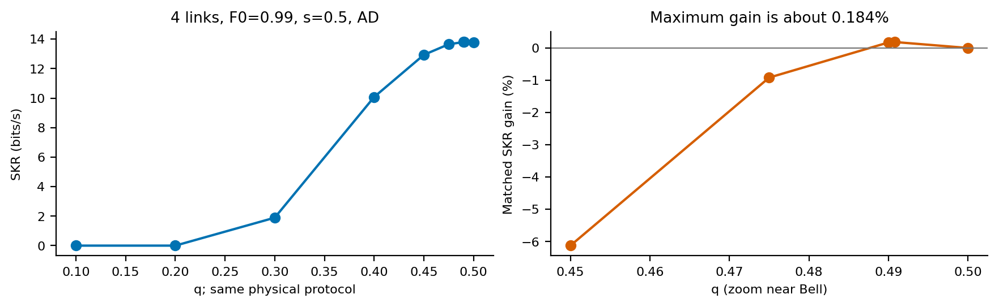
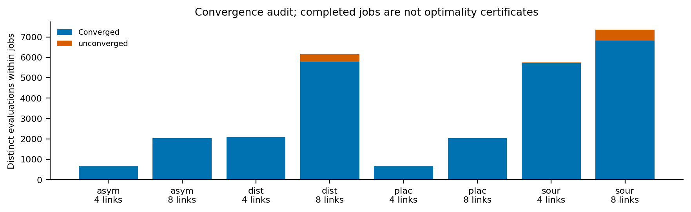

**The metropolitan batch reaches positive key and gives a constructive
postselection result: selecting Psi only at the first swapping level enables
eight-link key from fixed partially entangled sources where every uniform
acceptance policy gives zero.** The effect also occurs under unital noise,
so its main mechanism is source concentration and avoiding unnecessary
retries, rather than a benefit unique to amplitude damping.

The strongest practical gains come from choosing distillation count and
placement for the delivered source state. Allowing recurrence turns several
zero-rate Bell-source cases into positive-rate cases. In contrast, free
optimization of the source parameter $q$ gives only small matched gains,
at most **0.184%** in this batch. Asymmetric hardware does not produce a
per-swap postselection advantage among the candidates evaluated.

These conclusions concern an optimistic hybrid hardware model, pooled
asymptotic BB84 key, and a bounded protocol family. They do not establish
global protocol optima, a scaling law or literature priority. The earlier
[ideal-hardware report](pauliAD-ideal-hardware-report.md) and
[long-distance all-zero report](pauliAD-long-distance-report.md) are archived
separately with their original evidence.

## Experiment and audit

All **288 jobs** completed from **29 October, 21:05 to 30 October, 06:18 CET**,
about **9 h 13 min** with two workers. Summed subprocess elapsed time was
18 h 21 min; this is not measured CPU time. There were no failed jobs or
timeouts.

| Quantity | Result |
|---|---:|
| Trial requests, including cached repeats | 37,354 |
| Distinct candidate evaluations, summed within each job | 26,736 |
| Distinct hardware/candidate descriptions across jobs | 17,304 |
| Converged evaluations | 25,780 (96.4%) |
| Unresolved horizons | 956 (3.6%) |
| Backend physicality/evaluation failures | 0 |
| Positive-key converged evaluations | 7,974 |
| Positive reported stage winners | 374 / 672 |

These are computational counts, not independent experimental observations.
There is one optimizer seed, 7. Perfect and source-AD controls repeat across
the two nominal fidelity regimes because their actual input states are
identical. Bayesian searches used 60 proposals per stage plus anchors and
matched controls; repeated controls are not extra replication.

### Hardware and conventions

The [reference note](metropolitan-reference.md) documents the literature,
generation-prefactor calibration and pilot checks. Both regimes use:

| Parameter | Value |
|---|---|
| Elementary span / chain span | 5 km / 20 km or 40 km |
| Channel loss | 1.5 dB over the combined midpoint photon paths |
| Attempt duration | 35 microseconds, including assumed 10-microsecond local overhead |
| Generation success per attempt | 0.0036793, about 105 successes/s per elementary link |
| Swap hardware success | 0.85 |
| Memory times | $(T_1,T_2)=s(2.4,1.71)$ seconds |
| Memory scales | 0.5, 1, 2 |
| Recurrence budget | At most two rounds per vertex and two in total |

The memory reference is informed by [Bradley et al.](https://doi.org/10.1038/s41534-022-00637-w).
The passive fibre loss is supported by
[Agarwal et al.](https://doi.org/10.1103/PhysRevX.4.041038), without using
amplification. The combined memory/interface performance is an assumption,
not a demonstrated integrated device. The 0.97 fidelity reference has a
remote-atom precedent in [Saha et al.](https://doi.org/10.1038/s41467-025-57557-4);
0.99 is an optimistic photonic reference supported by
[Craddock et al.](https://doi.org/10.1103/PRXQuantum.5.030330).

AD waiting noise assumes relaxation toward $|0\rangle$, with
$\kappa=1/T_1$, $\Gamma_X=\Gamma_Y=1/T_2-1/(2T_1)$ and $\Gamma_Z=0$.
The unital control has the same longitudinal/transverse decay times but
zero AD and Pauli mode rates $(1/T_2,1/T_2,1/T_1)$. Decay times alone do not
identify the relaxation fixed point.

Sources are

$$
\rho_{q,v}=v|\psi_q\rangle\langle\psi_q|+(1-v)I/4,
\qquad |\psi_q\rangle=\sqrt{1-q}|00\rangle+\sqrt q|11\rangle.
$$

The labels `metro97` and `metro99` refer to the **Bell-reference fidelity**
$F_{\rm ref}=(1+3v)/4$, hence $v=0.96$ and $0.986667$. They are not the
actual initial fidelity of every PE or control state. For example,
at $q=1/4$ the initial $\Phi^+$ fidelities are approximately 0.90569 and
0.92391. The comparisons hold visibility fixed, not initial entanglement.

Perfect Bell sources and independent generation AD probabilities 5% and
15% per qubit are additional controls; their Bell fidelities are 1,
0.95125 and 0.86125. Source AD is applied at delivery without extra latency.
Preparation probability and cost are independent of $q$.
Generation probability is also held fixed across the two reference
fidelities; this is a controlled source-quality comparison, not a model of
an experimental rate–fidelity tradeoff.

The objective uses the pooled delivered state:

$$
e_X=(1-c_{XX})/2,\quad e_Z=(1-c_{ZZ})/2,\quad
\mathrm{SKF}=\max\{0,1-h_2(e_X)-h_2(e_Z)\},\quad
\mathrm{SKR}=\frac{\mathrm{SKF}}{\mathbb E[T]}.
$$

All rates below are **bits/second**, using the 35-microsecond slot.
Swap failures, outcome rejection, recurrence acceptance and copy preparation
are already included in $\mathbb E[T]$; no extra postselection factor is
multiplied into SKR. Operations are instantaneous and have no gate errors;
there are no cutoffs, finite-key effects, additional classical delays or
memory-count normalization.
Recurrence can use parallel copies, so these are not comparisons at fixed
total memory resources.

## 1. Postselection placement: concentrate PE sources early, then accept all

Placement fixes a balanced tree and no distillation. It compares all
corrected outcomes, Phi-pair and Psi-pair acceptance in three classes:
uniform throughout, one choice per level, and one choice per physical swap.

{width=100%}

For fixed **$q=1/4$ PE sources**, every positive best-level schedule accepts
Psi at the first swapping level and all corrected outcomes afterwards.
For four links this means `[psi_pair, all_corrected, psi_pair]` in physical
swap-boundary order. Policies are indexed spatially, not by execution order.

### Four links: almost exactly twice the throughput

At $F_{\rm ref}=0.99$, $s=1$ and AD:

| Fixed PE strategy | SKF | Mean wait (ms) | SKR (bits/s) |
|---|---:|---:|---:|
| Best uniform: Psi at every swap | 0.35079 | 152.98 | 2.29310 |
| Psi at first level, then all | 0.35094 | 76.50 | 4.58761 |

The output quality is almost unchanged; avoiding rejection at the final
swap halves the waiting time. This is principally a throughput gain from
placing concentration where it is useful, not a dramatic fidelity gain.
Across $s=0.5,1,2$, AD rates change from 1.1985, 2.2931, 2.9529 under the
best uniform policy to **2.3985, 4.5876, 5.9073** under the hybrid schedule.

For the lower-visibility regime, four-link PE key appears only at $s=2$
on this grid. AD gives $0.09328\to0.19380$ bits/s (2.078x), and unital noise
gives $0.03307\to0.07366$ (2.227x). The large ratios there accompany small
absolute rates near the key boundary.

### Eight links: a genuine positive-key extension relative to uniform PE policies

At $F_{\rm ref}=0.99$ and $s=2$:

| Waiting model | PE strategy | SKF | Mean wait (ms) | SKR (bits/s) |
|---|---|---:|---:|---:|
| AD | Uniform Psi | 0 | 519.92 | 0 |
| AD | First-level Psi, then all | 0.05300 | 124.87 | **0.42445** |
| Unital | Uniform Psi | 0 | 519.16 | 0 |
| Unital | First-level Psi, then all | 0.03290 | 124.69 | **0.26390** |

All three uniform policies converged and have zero rate. A converged
hybrid policy has positive rate. Therefore the advantage over the entire
uniform class is established numerically at these points, even though one
level schedule and most node schedules remain untested or unresolved.
It is a constructive advantage, not a certificate that the hybrid schedule
is globally optimal. No lifetime threshold was located between grid points.
The uniform Psi rows are the representatives returned by the margin tie
breaker, not unique rate winners among zero-rate policies. Uniformly
accepting all outcomes is faster still, about 44.07 ms, but also gives
zero key: concentration at the first level is essential, not merely the
removal of later rejection.

The mechanism is visible already without noise. For two identical pure
PE pairs, accepting the Psi outcomes gives a Bell pair after correction,
with probability $2q(1-q)=3/8$ at $q=1/4$. Once the first level has
concentrated the source, selecting Psi again at later levels often spends
another factor of acceptance probability without a compensating quality
gain. The actual evaluator includes the mixed inputs, noisy waiting and
all failed retries; the noiseless argument is intuition, not its calculation.
The unital result shows that this mechanism is not specific to AD.

{width=100%}

### What increases with network size, and what does not

The *advantage over the same PE source's uniform policies* changes from
about 2x at four links to enabling key at eight. Absolute performance still
worsens substantially. At AD, $s=2$, $F_{\rm ref}=0.99$:

| Source / policy | Four-link SKR | Eight-link SKR |
|---|---:|---:|
| Bell, all corrected | 20.7025 | 6.1882 |
| PE, best uniform | 2.9529 | 0 |
| PE, first-level Psi then all | 5.9073 | 0.4244 |

The hybrid PE SKF falls from 0.45157 to 0.05300, while its mean wait rises
from 76.44 to 124.87 ms. Much of its rate collapse comes from quality loss,
not only longer waiting. Bell rates fall less sharply. Thus this is not a
claim that PE sources outperform Bell, or that postselection improves the
best achievable network when $q$ is freely selectable.

No Bell-source placement improvement was found at any tested homogeneous
setting; its selected positive-rate policy accepts all outcomes. Level and
node rates agree at all 48 placement jobs. All 27 four-link schedules
converged in each of the 24 four-link jobs. Eight-link node searches remain
partial; 16/24 level searches fully converged, while all uniform baselines
were covered.

**Contribution assessment:** the strongest postselection result is its
placement and positive-region extension at fixed PE sources under stochastic
waiting and retries. Concentration itself is established physics; these
finite-network rate comparisons are a specific contribution candidate,
not a first-in-literature claim or a size-scaling law.

## 2. Bell-source distillation: count and placement depend on the input state

Both protocol searches optimize the tree and uniform acceptance; one allows
swaps only, the other allows recurrence. Among the 96 Bell-source jobs,
62 have positive best-with-recurrence rate versus 40 positive swaps-only
baselines: **22 job-level key activations**, including duplicated controls.
All positive selected protocols accept all swap outcomes.

{width=100%}

At reference memories ($s=1$), AD gives:

| Bell delivery model | Four links: swaps / best | Selected K | Eight links: swaps / best | Selected K |
|---|---:|---:|---:|---:|
| Perfect | 27.5912 / 27.5912 | 0 | 11.7120 / 11.7120 | 0 |
| Mixed, $F_0=0.97$ | 4.8687 / 9.4759 | 1 | 0 / 0.4954 | 2 |
| Mixed, $F_0=0.99$ | 18.1977 / 18.1977 | 0 | 3.3682 / 5.7731 | 1 |
| Source AD 5% | 0 / 7.3060 | 2 | 0 / 0 | — |
| Source AD 15% | 0 / 0 | — | 0 / 0 | — |

Among positive selected protocols, 26 use $K=0$, 20 use $K=1$ and 16 use
$K=2$. For zero-key jobs, the margin-based tie breaker does not identify
a meaningful rate-optimal count. At the weakest memories, even perfect
eight-link sources benefit from one terminal round:
**5.1531 to 5.6507 bits/s**, +9.66%, on the same balanced tree. The unital
control gives +11.0%. Waiting errors alone can make recurrence worthwhile.

### Strong gains and key activation survive realistic generation

Four mixed Bell links with $F_0=0.97$, AD and $s=0.5$ improve from
**1.8756 to 7.1051 bits/s**, a factor of 3.788, by adding one terminal round.
SKF rises $0.05202\to0.32677$ while mean wait rises
$27.73\to45.99$ ms. This gain is matched on the same balanced tree and
all-corrected acceptance, rather than being attributed to a different tree.
The corresponding unital rate ratio is 3.839.

At eight links, $F_0=0.99$, AD and $s=0.5$, one terminal round enables
**2.7310 bits/s from a zero swaps-only baseline**. Its errors change from
$(e_X,e_Z)=(0.12993,0.10839)$ to $(0.17596,0.01761)$.
Fidelity actually decreases slightly, $0.81588\to0.81523$, while SKF
becomes 0.20100. Lower bit error outweighs higher phase error in the key
formula. Fidelity alone would rank this change incorrectly for SKR.

### More recurrence is not always better

{width=100%}

For four mixed 0.97 sources, one terminal round is selected at every memory
scale. For four mixed 0.99 sources, no recurrence is selected. For eight
mixed 0.99 sources, one terminal round is selected throughout; it gives
2.7310, 5.7731 and 7.8046 bits/s across $s=0.5,1,2$.
For eight mixed 0.97 sources, the selected count changes from no positive
key at $s=0.5$, to two rounds at $s=1$, to one at $s=2$.
The earlier two-round pilot at $s=2$ gave 0.9559 bits/s; the search finds
1.2893 with one round. Optimizing the count matters beyond proving feasibility.

### Generation damping changes where purification belongs

Four source-AD-5% links are zero-key without recurrence at every scale.
Their best AD-memory rates become 4.1213, 7.3060 and 12.7887 bits/s.
At $s=2$, the selected sequence is

```
s0, s2, d1, d3, s1
```

It first makes the two half-chain links, distills each once, and then performs
the final swap. On this same source, memory setting and balanced tree,
the saved terminal-recurrence anchors give a direct placement comparison:

| Recurrence placement | Total K | SKF | Mean wait (ms) | SKR (bits/s) |
|---|---:|---:|---:|---:|
| One terminal round | 1 | 0.42880 | 52.20 | 8.21487 |
| Two terminal rounds | 2 | 0.55369 | 77.29 | 7.16377 |
| One round on each half-link | 2 | 0.57831 | 45.22 | **12.78865** |

Moving the two rounds onto half-links improves both quality and latency:
**78.5% more SKR than two terminal rounds**, and 55.7% more than the best
of the zero/one/two-terminal-round anchors. Retry costs are incurred on
shorter links and the parallel-copy resource structure changes. This is a
matched, concrete placement benefit, not an inference from unrelated GP
winners; it still does not establish global optimality.

With the higher-fidelity mixed 0.97 source, the selected
protocol instead distills only the final link once, giving 10.8380 bits/s.
The source-AD state starts at fidelity 0.95125 yet achieves the larger
best-found rate after purification. This is a warning against describing
source quality with fidelity alone. The protocols differ and searches are
not exhaustive, so it is not an equal-protocol or globally optimal source
dominance claim.

Source AD 15% remains zero-key throughout the bounded searches. It may
require a different recurrence basis, a larger resource budget or another
source/memory regime; this batch does not establish that none can work.

**Contribution assessment:** the broad recurrence tradeoff is known. The
useful result is a hardware- and state-dependent count/placement map with
actual retry costs, including key activation. The full input-state structure
and phase/bit-error balance explain more than initial fidelity alone.

## 3. Asymmetric hardware: no observed advantage from per-swap acceptance

The defects are a fivefold slower rightmost elementary link, or fourfold
shorter $T_1,T_2$ at one internal node, tested separately. Swapping stays
balanced and distillation is absent. Uniform, per-level and per-swap best
rates agree at **all 48 asymmetric jobs**, including 24 positive-rate jobs.
Every positive winner accepts all corrected outcomes.

{width=100%}

For AD and the mixed 0.99 source:

| Links / scale | Homogeneous | Slow rightmost link | Weak internal memory |
|---|---:|---:|---:|
| 4 / $s=1$ | 18.1977 | 4.0157 | 16.1799 |
| 8 / $s=1$ | 3.3682 | 0 | 2.5093 |
| 8 / $s=2$ | 6.1882 | 1.5269 | 5.6816 |

These rates include all retries. The slow-link defect extends synchronization
waits; it can remove positive key. The weak-memory defect damages stored
states without slowing all-corrected swap acceptance itself. Their factors
and spatial effects differ, so the table is not an equal-cost comparison
of hardware upgrades.

All 27 node schedules converged in every four-link asymmetric job. Uniform
acceptance is therefore numerically optimal within each finite fixed-tree
family, including 18 positive-rate settings. At eight links, all 3 uniform
and 27 level schedules converged, but node GP searched only a subset of
2187 possibilities. The six positive eight-link asymmetric cases do not
have a global node-policy certificate.

**Interpretation:** this is stronger than the earlier all-zero comparison,
but it does not establish a general level-compression theorem. Here the
best uniform policy already rejects nothing, so the study never exposes
a positive-rate setting whose optimum genuinely needs spatially different
Bell-outcome choices. Its contribution is a restricted negative result.

## 4. Optimizing q: real but small gains close to Bell

Of 96 source-search jobs, 62 return a positive joint winner. All those
winners have $q\in[0.49,0.5]$. The 31 positive unital winners all use
exactly $q=0.5$; among the 31 positive AD winners, 11 use $q<0.5$.
There is **no observed key activation from optimizing q**. These counts
include duplicated controls across regimes.

{width=100%}

The largest matched gain occurs for four links, $F_{\rm ref}=0.99$, AD
and $s=0.5$, on the same balanced swaps-only protocol accepting all outcomes:

| Source q | SKF | Mean wait (ms) | Fidelity | SKR (bits/s) |
|---:|---:|---:|---:|---:|
| 0.5 | 0.382076 | 27.7344 | 0.914336 | 13.776257 |
| 0.490801 | 0.382780 | 27.7344 | 0.914261 | 13.801627 |

The increase is **0.1842%**, or 0.02537 bits/s. Waiting is unchanged because
generation costs and all-corrected hardware acceptance are independent of
q in this model. $e_Z$ falls from 0.050643 to 0.050198, while $e_X$ rises
from 0.060343 to 0.060640. A small reduction in excited-state population
helps the key entropy balance without improving fidelity.

{width=100%}

For perfect four-link sources at $s=0.5$, the matched gain is 0.1608% at
$q=0.49393$; it falls to 0.0393% at $s=1$ and 0.0102% at $s=2$.
For the mixed 0.99 source, the analogous gains are 0.1842%, 0.0407% and
0.0094%. The largest observed eight-link gain is only about 0.0049%, for
perfect sources at $s=1$. No positive source-AD-5% case gains from q tuning;
their reported positive joint winners use Bell.

The largest matched gain is well above its observed last-horizon numerical
change: both compared rates change by only about $10^{-11}$ relatively on
the final doubling. This supports a genuine small model-level effect, not
truncation noise. It does not prove the global q optimum: only one GP seed
and a finite q profile were explored.

### Search variation can exceed the source effect

With four source-AD-5% links, AD memories and $s=2$, the Bell-only protocol
study finds 12.7887 bits/s, whereas the source study's joint winner reaches
10.0026, also at $q=0.5$. The runs differ in search history and anchors;
they find different recurrence placements. This roughly 28% rate spread
must not be attributed to source imbalance. A superset search cannot be
assumed to find every strong protocol discovered by a different run.

Consequently, separate best-found search rates are complemented here by
fixed-protocol q controls. The small matched improvements above survive
that attribution check. Positive-region extension from strongly imbalanced
sources does not. Zero-key jobs still sometimes select q near 0.1 through
the margin tie breaker; those values are not evidence of source optimality.

**Contribution assessment:** this is a useful negative result for network
rate optimization: the observed benefit of free q tuning is much smaller
than count/placement effects. [Wang et al.](https://arxiv.org/abs/1309.3818)
study single-pair residual correlations, not stochastic repeater SKR;
the result neither contradicts PE robustness nor proves Bell optimality
outside this search family. Source preparation costs independent of q and
the fixed recurrence basis remain important assumptions.
The q optimizer also uses **uniform** swap acceptance, unlike the successful
fixed-PE placement study. Joint optimization of q with per-level acceptance
was not performed. Its absence limits any general conclusion about the
best source across the combined protocol space.

## Reliability, limits and next experiments

Every reported winner passed coverage at least 0.999999 at two consecutive
horizons and metric agreement at `rtol=1e-5, atol=1e-9`. The cap was
1,048,576 slots, or 36.70 s with the metropolitan slot. A read-only audit
rechecked every converged candidate's saved histories, errors, SKF and SKR.

{width=100%}

| Study | Four links: converged / unresolved | Eight links: converged / unresolved |
|---|---:|---:|
| Placement | 648 / 0 | 2,027 / 9 |
| Distillation | 2,102 / 0 | 5,779 / 369 |
| Asymmetry | 648 / 0 | 2,038 / 0 |
| Source optimization | 5,719 / 33 | 6,819 / 545 |

Of 956 unresolved candidates, 560 failed coverage and 396 lacked a second
covered horizon. Only two final truncated diagnostics had positive SKR,
both duplicated versions of a low-q perfect-source case, about 0.330 bits/s
versus a converged winner near 31.2. No unresolved final diagnostic exceeded
its job's best converged rate. These diagnostics are not rigorous bounds
on missing tails; excluded candidates remain unresolved.

Of 1,581 stored q-profile rows, 1,527 converged and 54 did not. Failure to
observe a better q or node schedule is not proof that none exists. In
contrast, the eight-link PE activation compares a converged constructive
policy against a fully evaluated uniform class; that conclusion does not
require a global node-policy certificate.

The evidence supports three different statements, which should stay separate:

1. **A real fixed-source placement advantage:** PE concentration early and
   no later rejection can enable key where uniform acceptance fails. Test
   the neighborhood of the eight-link point to locate a lifetime boundary,
   then repeat for more sizes before claiming scaling.
2. **A larger practical Bell-source protocol advantage:** recurrence count
   and placement enable key and produce substantial rate gains. Test
   promising structures across more seeds and compare with an alternating-
   basis or other recurrence before drawing broad source-quality conclusions.
3. **A small matched q effect:** optimize q locally on strong, fixed protocols
   and seed joint searches with the best Bell protocols from *all* relevant
   runs. Then include per-level acceptance in that joint search. This
   separates source physics from incomplete protocol search and tests the
   combined space used only partially by the present studies.

The existing balanced-tree asymmetric cases show no need for per-swap
acceptance. A more discriminating follow-up would first locate a regime
where postselection is actually advantageous for the constrained source,
then introduce a spatial defect there. Adding more asymmetric zero-key or
uniformly all-corrected optima would give weaker information.

The strongest contribution candidate is therefore **state-aware protocol
placement with modeled stochastic waiting and retry costs**. The present data do not
show that PE sources beat freely chosen Bell sources, that the q advantage
grows with size, or that per-level policies are universally optimal. Novelty
assessments are conditional interpretations, not a new systematic priority
search.

## Reproducible evidence and earlier batches

The original metropolitan results are unchanged. The
[evidence directory](pauliAD-metropolitan-report/README.md) contains complete
candidate and winner tables, q profiles, matched controls, count-specific
comparisons, figures and hashes of 1,442 input files. All sources, sizes,
memory scales and models are retained, including controls not shown in the
illustrative figures. From the activated repository environment:

```bash
python -m src.analysis.plot_pauli_ad_metropolitan_report
```

This runs no optimizer or backend evaluation. The earlier
[long-distance report](pauliAD-long-distance-report.md),
[ideal-hardware report](pauliAD-ideal-hardware-report.md) and
[metropolitan pilot/reference](metropolitan-reference.md) remain available.
The first two concern different hardware grids; the pilot evaluates fixed
anchors rather than optimized protocols. Their conclusions should not be
silently substituted for this completed search.
