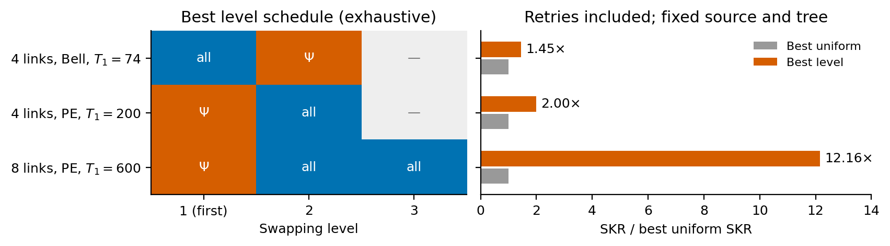
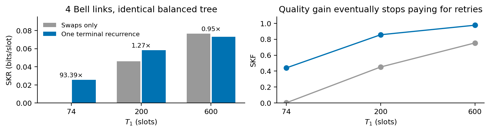
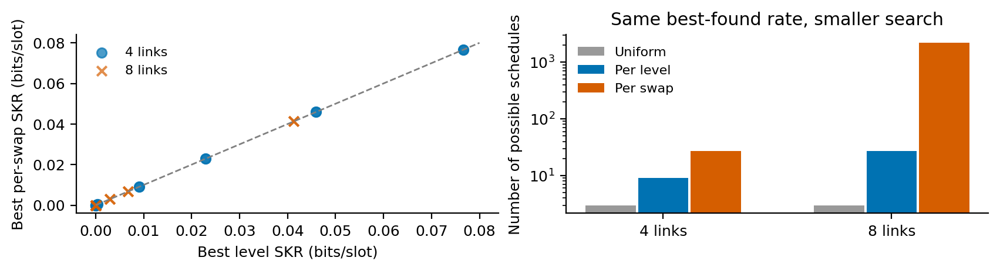
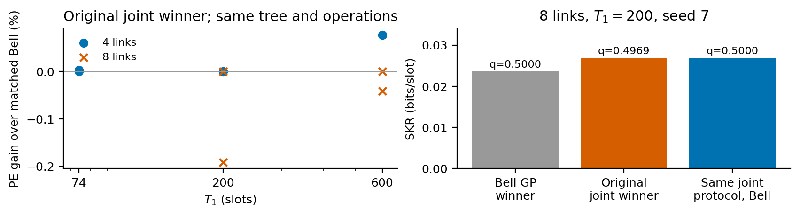

**The strongest contribution candidate is choosing where in the tree to
postselect, rather than a general advantage of partially entangled sources.**
The results below are ranked by scientific interest and estimated novelty.
Novelty assessments reflect a targeted primary-source literature check, not
established priority.

**Scope.** Four/eight elementary links (five/nine nodes), homogeneous hardware,
$p_{\mathrm{gen}}=0.2$, ideal instantaneous swap/distillation hardware, and
amplitude damping during waiting: $T_2=2T_1$. Sources are
$|\psi_q\rangle=\sqrt{1-q}|00\rangle+\sqrt q|11\rangle$; Bell means $q=1/2$,
PE here means $q=1/4$. The grid is $T_1\in\{25,74,200,600\}$ slots, with
optimizer seeds 7 and 42. Our metric is

$$
R=\mathrm{SKR}=\frac{\max\{0,1-h_2(e_X)-h_2(e_Z)\}}{\mathbb E[T]}.
$$

Rejection, regeneration and distillation preparation are included in $T$.
There are no cutoffs, preparation damping, classical-message delays or
normalization by memory count. Distillation uses the existing recurrence,
without Werner twirling. Placement experiments fix a balanced tree and no
distillation; protocol searches also vary the tree and allow one recurrence
round per tree vertex; their acceptance policy remains uniform. Rates below
are bits/slot.

## 1. The useful postselection level depends on the source and noise regime

**Novelty estimate: medium as a specific network-rate result.** Entanglement
concentration through swapping is established: [Song et al. (2014)](https://arxiv.org/abs/1306.4451)
study recovery under amplitude damping, and [Davies et al., Sec. IV](https://arxiv.org/html/2509.16689v1#S4)
show outcome-dependent concentration for PE inputs. Our additional result is
the optimized *placement* and its throughput after noisy waiting and retries.
Heralded AD recovery using an extra reversal operation is also studied by
[Jeong et al. (2026)](https://arxiv.org/abs/2602.21563).

{width=100%}

For **four Bell links at $T_1=74$**, the exact optimum among all 27 schedules
accepts all first-level outcomes and selects $\Psi$ only at the root:
$R=0.00027212\to0.00039563$ (**+45.4%**). SKF rises
$0.002677\to0.007820$, outweighing the waiting-time increase
$9.84\to19.77$ slots. This confirms and certifies the earlier notebook example.

For **PE links**, select $\Psi$ at the first level and accept all outcomes
afterwards. Four links at $T_1=200$ gain **2.00×** over the best uniform policy.
Eight links at $T_1=600$ gain **12.16×**:
$R=0.00055142\to0.00670679$, SKF $0.08849\to0.25552$, and wait
$160.48\to38.10$ slots. Here avoiding later rejection improves both quality
and delay. The interpretation is concentration early for imbalanced sources,
versus filtering accumulated waiting noise late for Bell sources; this is a
mechanistic explanation, not a separately isolated causal test.

The 12× comparison is against the **same PE source**. Bell sources accepting
all outcomes already reach $0.04128$ at that eight-link point. It does not
establish PE superiority, or a scaling law from two chain lengths.

## 2. Terminal distillation can dominate postselection, even with fresh perfect Bell links

**Novelty estimate: medium for this quantitative regime; low for the general
swap-then-distill idea.** [Haldar et al., Fig. 7 and distillation discussion](https://arxiv.org/html/2401.13168v3)
already compare both orders. [La Corte et al., Sec. V.A](https://arxiv.org/html/2502.02208v1#S5.SS1)
find early distillation in their studied Werner-source regimes. Our AD-memory
example illustrates a different optimum; it does not contradict their
parameter-specific conclusions.

{width=100%}

At $T_1=74$, appending one end-to-end recurrence to the balanced Bell protocol
gives $R=0.00027212\to0.02541359$ (**93.39×**). SKF rises
$0.002677\to0.44044$, while mean wait increases only
$9.84\to17.33$ slots. It also beats the best no-distillation postselection
schedule by **64.24×**. At $T_1=200$, the matched gain is 27.1%; at $600$,
terminal recurrence instead lowers SKR by 4.79%, despite improving SKF.

Fresh links start perfect, so waiting creates the errors that later
purification removes. The useful choice depends on how much key fraction
there is to recover. This is the strongest practical warning against
optimizing postselection in isolation. Extra parallel-copy resources are
allowed by the evaluator, so this is not a memory-normalized advantage.

## 3. One policy per level captures every best per-swap rate found

**Novelty estimate: low-to-medium, as a restricted search-space reduction
conjecture.** [Li et al. (2021)](https://arxiv.org/abs/2005.04946) found little
benefit from nonuniform cutoffs in their symmetric chains. Here nonuniform
postselection can matter greatly, but variation *between levels* appears
sufficient on the tested homogeneous balanced trees.

{width=100%}

The best level and per-swap rates agree at every tested setting: 16 distinct
size/lifetime/source points, each searched with two seeds. For four links,
all 27 per-swap schedules were evaluated, so equality is established
numerically on those eight parameter points. For eight links, the 27 level
schedules were exhaustive, but per-swap GP searched only a fraction of 2187
schedules and was seeded with the level optimum. Equality there is weaker
evidence.

**Working hypothesis:** use one policy per nesting level before searching
spatial asymmetry. This reduces the eight-link policy space by 81×. Symmetry
of the hardware alone is not a proof that a symmetry-breaking policy cannot
win; heterogeneous or unbalanced chains remain untested.

## 4. Optimizing $q$ gives small matched gains; larger apparent gains can come from the tree

**Novelty estimate: low as a physical principle; useful as a negative result
and an attribution check.** [Wang et al.](https://arxiv.org/abs/1309.3818)
establish PE robustness for single-pair correlation measures. They do not
imply a repeater SKR advantage. The present contribution is testing that
tradeoff under multilevel waiting and protocol optimization.

{width=100%}

All positive-key **reported joint winners** use $q\geq0.495$. For four links
at $T_1=600$, $q\simeq0.4952$ gives only **0.0771%** over the matched Bell
protocol, consistently across seeds. No positive joint winner uses uniform
Bell-outcome rejection.

For eight links, $T_1=200$, seed 7, the reported joint rate exceeds the Bell
search winner by **13.88%**. Both reported winners actually use Bell sources,
all outcomes, and one terminal recurrence: the difference is the swap tree.
The original joint candidate had $q=0.4969$; resetting it to $1/2$ raises its
rate further, from $0.02680256$ to $0.02685390$. Thus the large gain cannot
be credited to PE sources. Different seeds also find different trees, so
the best-found rates should not be called global optima.

## Evidence limits and next decision

The batch completed 48 jobs and 8120 distinct backend evaluations. Of these,
7928 converged; 136 lacked convergence and 56 failed physicality checks.
They were excluded, not treated as zero key. All reported winners passed
coverage and successive-horizon checks. Two seeds are search replicates,
not a statistical confidence interval. The coarse four-point lifetime grid
demonstrates no new positive-key boundary or threshold scaling law.

**Priority for follow-up:** refine the source-dependent level schedules
around the key boundary, then compare them jointly with terminal recurrence
at fixed resource assumptions. A broad claim that PE sources improve the
optimized network, or that per-level policies are always optimal, is not
supported by this batch. The two leading findings merit further study;
none of these novelty estimates establishes a first-in-literature claim.

**Provenance.** All plots use existing files in
`results/pauliAD/overnight/`; no evaluator was run for this report. Exact
numbers, matched trial IDs, figure data and input hashes are saved in
`pauliAD-overnight-report/`, beside this document. Regenerate figures from
the repository root:

```bash
python -m src.analysis.plot_pauli_ad_overnight
```

Literature checked on 27 October 2026.

## Hardware follow-up prepared on 28 October 2026

The original figures above remain the results of the ideal-hardware batch.
The new `--preset hardware` addresses the same four questions with lower
generation probabilities, imperfect swap success, source imperfections and
independent longitudinal/transverse memory decay. Its results must be read
from its own output directory; they do not replace the evidence above.

**Hardware and units.** We reuse the actual values in
`src/scripts/reproduce_results.py`, including its modified scenario-C
visibility, rather than copying the slightly different paper table:

| Regime | Link length | $p_{\rm gen}$ | $p_{\rm swap}$ | Source visibility $v$ | Slot duration |
|---|---:|---:|---:|---:|---:|
| C | 50 km | 0.00092 | 0.85 | 0.960 | 250 microseconds |
| D | 20 km | 0.00260 | 0.85 | 0.958 | 100 microseconds |

We adopt propagation speed $2\times10^8$ m/s and one slot $L_0/c$.
These are hybrid hardware-informed benchmarks, not a calibrated simulation
of one experimental device. Visibility means
$\rho=v|\psi_q\rangle\langle\psi_q|+(1-v)I/4$; for Bell sources,
$F_0=(1+3v)/4$, hence $F_0=0.970$ in C.

**Memory reference.** [Bradley et al., npj Quantum Information 8, 122
(2022)](https://doi.org/10.1038/s41534-022-00637-w) measure nuclear-memory
decay during repeated optical entangling operations. Their corrected
longitudinal and transverse times are approximately 2.4 s and 1.71 s.
The corrections condition on charge/resonance checks; their overhead is
not simulated here, so this is an optimistic reference. We use these as
effective $T_1,T_2$, giving $(9600,6840)$ slots in C and $(24000,17100)$ in D.
A scale $s$ multiplies both lifetimes; $s<1$ tests stronger waiting noise.
The AD model uses

$$
\kappa=\frac{1}{T_1},\qquad
\Gamma_X=\Gamma_Y=\frac{1}{T_2}-\frac{1}{2T_1},\qquad \Gamma_Z=0.
$$

Those measured decay times **do not establish ground-state amplitude
damping**. Therefore `--relaxation-models ad unital` also tests unbiased
relaxation with the same $T_1,T_2$: no AD and Pauli mode-decay rates
$(1/T_2,1/T_2,1/T_1)$. This separates effects of lifetime from effects of the
relaxation fixed point. The source AD tests remain explicitly imposed
source-channel assumptions under either waiting-memory model.

For comparison, `--memory-profiles benchmark` matches the old homogeneous
scalar decay of $c_{XX}$: $\exp(-t/t_{\rm coh})=\exp(-2t/T_2)$, hence
$T_2=2t_{\rm coh}$ and **assumed** $T_1=10T_2$. In C this gives
$T_2=2.8\times10^6$, $T_1=2.8\times10^7$ slots. This matches one decay
coefficient, not the full old depolarizing channel, and is not a new
measurement. Old heterogeneous per-node coherence times use a different
convention and should not be substituted into this scalar conversion.

**The four evaluations.**

1. **Placement:** fixed balanced tree, no distillation, both Bell and
   $q=1/4$ sources with benchmark visibility. Search uniform, per-level and
   per-swap acceptance over the memory grid. The new placement figure has
   Bell sources on the first row and PE sources on the second; each row
   shows the best level schedule and its same-source SKR gain over uniform
   acceptance. A companion plot gives absolute SKR, including zero-baseline
   cases that cannot appear as ratios. Zero-key schedules are left blank.
2. **Distillation:** Bell sources only. Compare the best swaps-only protocol
   with the best protocol found allowing recurrence, optimizing tree and
   uniform acceptance in both. Test perfect delivery, benchmark mixed
   delivery, and independent source AD probabilities 0.05 and 0.15 per
   qubit. The main plot labels the winning total count $K$; a second plot
   separates the best sampled rates for $K=0,1,2$. Counts include leaves
   and internal vertices. This is broader than adding terminal recurrence
   to one fixed tree, but remains a bounded best-found search.
3. **Asymmetry:** retain the balanced topology but break hardware symmetry:
   either slow the rightmost elementary link by a factor of five, or
   shorten one internal node's two memory lifetimes by a factor of four.
   Compare per-level and per-swap policies, using the uniform baseline.
   The defects are separate tests, so their effects can be distinguished.
4. **Source optimization:** compare the optimized Bell protocol with the
   optimized $q$ protocol under the same hardware, including noisy waiting
   and source AD. On both winning protocols, evaluate a one-dimensional
   $q$ grid including $1/2$, with extra resolution near $1/2$. Save both
   reoptimized and fixed-protocol comparisons: a better tree must not be
   credited to the source. Plot SKR against memory scale and against $q$.

Source damping is applied to every freshly delivered link; it does not add
an extra timed storage stage. Preparation probability/time remain independent
of $q$. Distillation hardware has no extra failure by default, but the
backend's state-dependent recurrence acceptance and preparation/retry costs
are included. Local operations remain instantaneous and free of gate errors;
there are no cutoffs, classical delays or finite-key effects. These limits
are essential when interpreting hardware-informed rates.

**Run.** A first batch covers both chain sizes, both relaxation assumptions,
three memory scales and all four questions (144 jobs with default source
tests). Additional seeds, regime D and finer scales can follow separately.

```bash
source venv/bin/activate
caffeinate -i python -m src.scripts.gp_pauliAD \
  --preset hardware --hardware-regimes C --nodes 5 9 \
  --memory-scales 0.5 1 2 --relaxation-models ad unital \
  --seeds 7 --gp-calls 60 --max-dists 2 --max-total-dists 2 \
  --workers 2 --case-timeout 7200 \
  --output results/pauliAD/hardware-followup
```

Add `--dry-run` to inspect the plan, or `--resume` to repeat exactly this
plan after interruption. A fixed overnight completion time is not guaranteed.
The default horizon grows from 16384 to 1048576 and retains the original
two-horizon coverage/stability requirements. Unresolved candidates remain
missing; `unresolved.csv` identifies them. A larger cap requires a new
output directory, not replaying cached failures.

Read `summary.txt`, `comparisons.csv`, `distillation_counts.csv` and
`q_profiles.csv`, plus the numbered PNG/PDF figures. Rates and waits are
saved in both slot and physical units. The full plan records every hardware
array and command; each job retains its trial journal and convergence
history. These analyses are prepared for execution; the short smoke runs
are software checks, not extensive scientific results.
