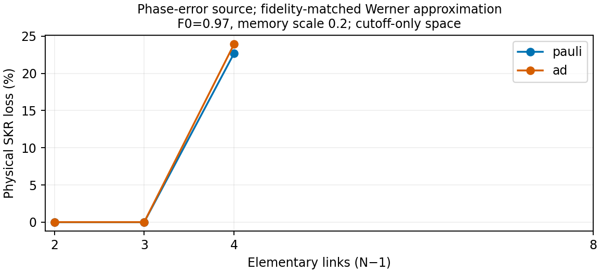
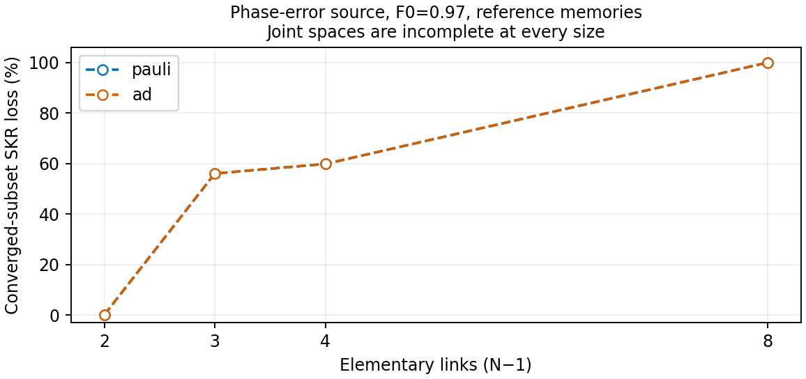

We consider homogeneous repeater chains and investigate whether a protocol
that maximizes the secret-key rate in an approximated model remains efficient
when evaluated with a more complete description of the same hardware. The
completed batch retains a **23.94% loss from a Werner-selected cutoff in a
fully evaluated, three-protocol space**. The new eight-link results give a
stronger constructive example: the Werner-source model prefers a protocol
that produces **zero physical key**, while a resolved alternative produces
**1.40368 bits/s**. Both model rankings are strict for this pair. The joint
protocol spaces remain numerically incomplete, however, so this does not
establish their full-space optimization loss.

The distinction between approximations is important. Large observed losses
come from erasing source error composition with a Werner replacement. The
largest observed **channel-twirl** selection loss remains **0.4648%**, in
one converged joint subset. The completed grid does not establish a large
or widespread channel-induced optimization penalty.

This note follows the terminology and notation of La Corte et al.,
[*Bayesian Optimization for Repeater Protocols*](https://arxiv.org/abs/2502.02208)
(QCNC 2025): **repeater protocol**, **protocol space**, **hardware regime**,
**figure of merit**, and distillation at the **link-level**, **intermediate
levels**, or **end-to-end level**. In particular, $N$ denotes the number of
nodes, so the chain contains $N-1$ elementary links. The local manuscript is
[`qcnc2025-paper/main.tex`](</Users/lorenzolacorte/Research/qcnc2025-paper/main.tex>).

**Snapshot:** 2 November 2026, **08:50:56 CET** (07:50:56 UTC), with **192/192
jobs completed**. The batch ran from 31 October, 19:20:07 CET to 2 November,
02:36:06 CET, approximately **31 h 16 min** with two workers. All 77,760
candidate/model evaluations were attempted; only 48,747 converged.
The [frozen evidence](twirled-model-optimization/evidence.json) records the
input checksums, comparison scopes, selected protocols and numerical histories
for the representative results. A completed job means that its protocol list
has been processed; it does not mean that every evaluation converged.
The [1 November interim report](twirled-model-optimization-20261101/report.md),
[PDF](twirled-model-optimization-20261101/report.pdf) and evidence are archived
separately.

## 1. Methodology

### Repeater protocols and protocol spaces

Following Section III of the QCNC paper, a repeater protocol is represented
by a binary tree. Leaves represent freshly generated elementary links;
each internal vertex represents the link produced by swapping its two
children. A vertex label specifies the number of rounds of entanglement
distillation performed on that link. There are $v=2N-3$ vertices. We denote
the label at vertex $i$ by $\kappa_i$ and the total number of rounds by
$\mathcal K=\sum_i\kappa_i$.

The QCNC parameter $\beta$ limits rounds per vertex. The present global
budget $\mathcal K\leq2$ is more restrictive than taking $\beta=2$ over
the full protocol space.

We extend this description with a shared memory-time cutoff $t_{\rm cut}$
and an acceptance rule at each swapping vertex: accept all corrected Bell
outcomes, the Phi pair, or the Psi pair. Upon failure, the consumed input
links must be generated again. These retries are included in the waiting
time of the protocol.

The current batch fixes a balanced swapping tree for four and eight links,
and a near-balanced tree for three links. **It does not optimize tree
symmetricity.** The QCNC paper's finding that balanced trees perform well
in homogeneous hardware motivates this choice; it does not establish
optimality for the enlarged operation and noise model used here.

The restricted protocol space contains:

- Three cutoff choices: no cutoff, 136 slots, or 544 slots. These are
  approximately $0.5/p_{\rm gen}$ and $2/p_{\rm gen}$ for the finite cutoffs.
- Distillation with $\mathcal K\leq2$: none; one or two rounds at the root;
  one round at each root child; or one round at every elementary link or
  first swapping output when the total budget permits it. This is a
  selected family of placements, not every assignment with $\mathcal K\leq2$.
- Six acceptance patterns before deduplication: all corrected; uniform Phi;
  uniform Psi; Psi only at the first swapping layer; Phi only at the final
  swap; or Psi only at the final swap.

Four nested restrictions separate the effects of the available controls:

| Protocol space | Optimized controls | Fixed controls |
|---|---|---|
| $P_{\rm swap}$ (`swaps`) | Shared cutoff | No distillation, all corrected |
| $P_{\rm D}$ (`distillation`) | Cutoff and distillation count/placement | All corrected |
| $P_{\rm A}$ (`postselection`) | Cutoff and Bell-outcome acceptance | No distillation |
| $P_{\rm DA}$ (`joint`) | All listed controls | Fixed swapping tree |

After deduplication, the joint space has 36, 90, 72 and 72 protocols for
$N-1=2,3,4,8$, respectively. The larger count for three links arises because
its near-balanced tree gives additional distinct intermediate-level
distillation placements. The cutoff-only space has exactly three protocols
for every chain size.

Section IV-B of the QCNC paper uses Bayesian optimization to investigate
large protocol spaces. **Here we use brute-force evaluation of a restricted
space.** Every model evaluates the same protocols, so a disagreement cannot
be attributed to different stochastic search trajectories or shot budgets.
An optimum is always qualified by the protocol space over which it is found.

### Figure of merit and loss from model-based optimization

As in Section IV-A of the QCNC paper, the figure of merit is the BB84
secret-key rate (SKR), combining the quality of the end-to-end link and the
average waiting time needed to distribute it. We first pool the delivered
states over their completion times, then compute

$$
e_X=\frac{1-c_{XX}}2,\qquad e_Z=\frac{1-c_{ZZ}}2,\qquad
\mathrm{SKF}=\max\{0,1-h_2(e_X)-h_2(e_Z)\},\qquad
R=\frac{\mathrm{SKF}}{\mathbb E[T]}.
$$

Here $h_2$ is binary entropy. This is a pooled, asymptotic BB84 figure of
merit; it does not average the separately clipped SKF of individual time
bins. Hardware failures, rejected Bell outcomes and distillation retries
already contribute to $\mathbb E[T]$. No additional success factor is
multiplied into the rate. Unless indicated otherwise, rates below are in
**bits per second**.

For a hardware regime $h$ and a protocol space $P$, let $R_{\rm full}(\pi;h)$
denote the rate computed with the full real-X model and $R_m(\pi;h)$ the
prediction of approximation $m$. We compare

$$
\pi^*_{\rm full}\in\arg\max_{\pi\in P}R_{\rm full}(\pi;h),\qquad
\widehat\pi_m\in\arg\max_{\pi\in P}R_m(\pi;h),
$$

$$
\Delta R_m=R_{\rm full}(\pi^*_{\rm full};h)
              -R_{\rm full}(\widehat\pi_m;h),\qquad
\ell_m=\frac{\Delta R_m}{R_{\rm full}(\pi^*_{\rm full};h)}.
$$

Both rates in the loss are evaluated on **the original source and hardware**.
The comparison therefore measures the cost of selecting a protocol using
the approximation, not the difference between two predicted maxima. The
full model is our reference simulation, not an experimental ground truth.

If some evaluations are missing, the implementation replaces $P$ by the
subset on which both models converge. Such comparisons are labelled
**provisional** below: their loss need not equal the loss over the full $P$.
The physical execution score is already available from evaluating every
candidate under the full model; no additional approximate-to-physical
conversion is applied to that score.

Exact prediction ties are broken by candidate ID, without consulting the
physical rate. We also report the minimum and maximum physical loss over
near-optimal prediction ties, using relative tolerance $10^{-4}$ and absolute
tolerance $2\times10^{-9}$ bits/slot. These are sensitivity ranges, not
statistical confidence intervals. A model predicting zero key for every
protocol has a tied optimum; this alone does not establish an unavoidable
optimization loss. Relative loss is undefined when the full-model optimum
is zero.

### Hardware regimes and initial link quality

The grid crosses $N\in\{3,4,5,9\}$, three source families, two initial
fidelities, four memory scales and two physical noise models: **192 regimes**.

| Parameter | Values |
|---|---|
| Internode distance $L_0$ | 5 km |
| End-to-end distance $(N-1)L_0$ | 10, 15, 20, 40 km |
| Elementary generation success $p_{\rm gen}$ | 0.0036793 per attempt |
| Attempt duration $\delta t$ | 35 microseconds |
| Swapping hardware success $p_{\rm swap}$ | 0.85 |
| Distillation hardware success | 1; state-dependent acceptance remains probabilistic |
| Initial Phi+ fidelity $F_0$ | 0.97, 0.99 |
| Memory scale $s$ | 0.05, 0.2, 1, 2 |
| Local memory times | $(T_1,T_2)=s(2.4,1.71)$ seconds |

The optical calibration retains a generation prefactor fitted to the C/D
benchmarks used with the QCNC framework, while shortening the elementary
span to obtain positive rates. The measured passive-fibre loss reference,
memory reference and source-fidelity references are documented in
[the metropolitan calibration note](metropolitan-reference.md). This is an
optimistic hybrid hardware model; its components have not been demonstrated
together. The QCNC paper's scalar $t_{\rm coh}$ is a Werner decay parameter
with its stated local/joint convention. We do **not** identify it directly
with either of these local $T_1,T_2$ values.

Writing $\Phi^\pm$ for the corresponding Bell projectors, the sources are

$$
\begin{aligned}
\rho_{\rm W}&=F_0\Phi^+ +\frac{1-F_0}{3}(I-\Phi^+),\\
\rho_Z&=F_0\Phi^+ +(1-F_0)\Phi^-,\\
\rho_R&=F_0\Phi^+ +(1-F_0)|01\rangle\langle01|.
\end{aligned}
$$

The three families have the same Phi+ fidelity but different error
composition or local biases. Their preparation costs are held fixed. They
are controlled input families, not a claim that a particular interface
produces all three at the same rate. Partially entangled sources and
optimization of their imbalance are not part of this batch.

### Physical noise and approximated models

The AD model combines relaxation toward $|0\rangle$ and pure dephasing. In
physical time, its local Pauli mode rates and AD rate are

$$
\kappa=1/T_1,\qquad
(\Gamma_X,\Gamma_Y,\Gamma_Z)
=\left(1/T_2-1/(2T_1),1/T_2-1/(2T_1),0\right).
$$

The unital Pauli control has rates $(1/T_2,1/T_2,1/T_1)$ and $\kappa=0$.
Thus both have the same Bloch contractions
$(e^{-t/T_2},e^{-t/T_2},e^{-t/T_1})$; only the AD model has the affine shift
$z\mapsto e^{-t/T_1}z+1-e^{-t/T_1}$. Rates are converted to slots in the
implementation. The reference memory measurements motivate the decay times,
not the assumed ground-state fixed point of AD.

Let $B$ denote Bell-diagonal state twirling and $W$ fidelity-preserving
Werner state twirling. We distinguish six models:

| Model | Source replacement | Waiting noise | Replacement after each successful operation |
|---|---|---|---|
| `full` | None | Physical | None |
| `bell_source` | $B(\rho_0)$ | Physical | None |
| `werner_source` | $W(\rho_0)$ | Physical | None |
| `channel_twirl` | None | Local Pauli-channel twirl | None |
| `bell_channel_twirl` | $B(\rho_0)$ | Local Pauli-channel twirl | None |
| `bell_each_stage` | $B(\rho_0)$ | Physical | Apply $B$ |

For general Pauli–AD rates, the local channel twirl replaces
$(\Gamma_X,\Gamma_Y,\Gamma_Z,\kappa)$ with
$(\Gamma_X+\kappa/2,\Gamma_Y+\kappa/2,\Gamma_Z+\kappa,0)$.
It preserves the contractions while removing the translation.

In particular, `werner_source` is **only an input-state approximation**;
it still propagates real-X states during waiting and distillation. It is
not the QCNC paper's assumption of Werner states at every stage. Likewise,
`bell_each_stage` permits biases to regenerate during storage intervals.
The combined `bell_channel_twirl` is the closed Bell-diagonal surrogate.
None of these prediction substitutions physically twirls the input of the
executed protocol.

## 2. Exactness controls

Davies, Avis and Wehner establish Bell-population equivalence for
non-postselected swap-and-correct protocols when replacing the input states
by their Bell-diagonal approximations
([Theorem 1](https://arxiv.org/html/2509.16689v1)). This provides a control
for the present study, rather than a competing explanation for all its
noise and operation settings.

For the implemented real-X bilateral-CNOT recurrence, let
$(u,z,x,y)=(c_{II},c_{ZZ},c_{XX},c_{YY})$ retain the success weight $u$.
The unnormalized output Bell sector is

$$
\begin{aligned}
u'&=(u_au_b+z_az_b)/2,&z'&=(z_au_b+u_az_b)/2,\\
x'&=(x_ax_b+y_ay_b)/2,&y'&=(y_ax_b+x_ay_b)/2.
\end{aligned}
$$

No local biases occur. Consequently,
$B D(a,b)=D(Ba,Bb)$, including the success probability. All-corrected
swapping also has a closed Bell sector, and local Pauli noise commutes
with $B$. The same identities hold for success-weighted time bins, time-only
cutoffs and retries. **Bell reduction therefore preserves the waiting-time
distribution and pooled BB84 SKR for all-corrected protocols under Pauli
storage, including this recurrence.** This argument is restricted to the
implemented state and operation family, not arbitrary purification maps.

The stored Pauli-noise diagnostics agree: across **1,005 resolved
all-corrected candidate pairs per Bell-source/stage model**, the maximum
fidelity discrepancy is zero and the maximum rate discrepancy is about
$1.1\times10^{-19}$ bits/slot. These are within-job candidate counts, not
independent statistical replicates.

There are two relevant boundaries. A local affine channel gives

$$
c'_{ZZ}=a_La_Rc_{ZZ}
 +a_Lb_Rc_{ZI}+b_La_Rc_{IZ}+b_Lb_Rc_{II}.
$$

Discarded local biases can therefore matter under subsequent non-unital
storage; channel twirling also removes the last term. Moreover, acceptance
probabilities of the Phi/Psi pairs depend on the local-bias product. Thus
postselection can expose information lost by state twirling even without
AD. Conversely, replacing an already Bell-diagonal source by $B(\rho_0)$
is an identity even when later storage is non-unital. This trivial control
must not be mistaken for evidence that intermediate Bell reduction is exact.

The recurrence here is the untwirled bilateral-CNOT core with equal target
outcomes accepted. It is not the complete BBPSSW procedure with Werner
preprocessing. A loss from a Werner-predicted protocol is not evidence of
an advantage over physically twirled or basis-adapted purification.

## 3. Numerical results


### A. A Werner-selected cutoff can reduce the rate without distillation

Consider $N=5$ nodes, $F_0=0.97$ phase-error sources and $s=0.2$, so
$(T_1,T_2)=(0.48,0.342)$ seconds. The swapping tree is balanced and all Bell
outcomes are corrected and accepted. Only the shared cutoff is optimized.
All three candidate cutoffs converge under both models.

| Physical waiting noise | Full-model cutoff | Werner-selected cutoff | Full-model optimum | Physical rate of Werner-selected protocol | Loss |
|---|---:|---:|---:|---:|---:|
| Pauli | 544 slots | 136 slots | 3.97945 | 3.07636 | 22.69% |
| AD plus dephasing | 544 slots | 136 slots | 4.04823 | 3.07926 | 23.94% |

Rates are bits/s. The AD case makes the quality–waiting-time trade-off explicit:

| Physical protocol | SKF | Average waiting time | Average Phi+ fidelity | SKR |
|---|---:|---:|---:|---:|
| Cutoff 544 | 0.138063 | 34.10 ms | 0.826428 | 4.04823 |
| Cutoff 136 | 0.353419 | 114.77 ms | 0.868598 | 3.07926 |

The shorter cutoff produces higher-quality links, but their average waiting
time is more than three times larger. The resulting SKF increase does not
compensate for the additional retries. The fidelity-only source description
therefore selects an excessively restrictive cutoff for the physical
phase-error source.

This is a **complete finite-space result**: $3/3$ protocols are resolved and
the approximate optimum is unique at the configured tie tolerance. It does
not establish optimality among arbitrary cutoffs or swapping trees. The
similar loss under Pauli noise shows that the main mechanism is loss of
error-composition information, not exclusively non-unitality.

### B. Werner-selected distillation can be detrimental

For the same $N=5$ and phase-error source with $F_0=0.97$, now take reference
memories $s=1$ and AD plus dephasing. In the resolved joint subset, the full
model selects no distillation, whereas the Werner-source model selects one
round on each two-elementary-link output, before the final swap. Both
protocols accept all corrected outcomes and use no cutoff.

| Physical protocol | $\mathcal K$ | SKF | Average waiting time | SKR |
|---|---:|---:|---:|---:|
| Balanced swapping without distillation | 0 | 0.357348 | 27.73 ms | 12.88463 |
| One intermediate-level round on each half | 2 | 0.192936 | 37.26 ms | 5.17824 |

The observed reduction is **59.81%** in the common converged subset.
Distillation increases $e_X$ from 0.12410 to 0.21490, while reducing $e_Z$
from 0.01325 to 0.00646. For this source, the reduction in bit errors is
insufficient to compensate for the increase in phase errors. Both SKF and
delivery efficiency deteriorate.

This is the QCNC paper's trade-off between improved quality through
distillation and additional waiting time, with a further issue: a
fidelity-matched source approximation can misidentify whether the chosen
recurrence improves the relevant quality at all. There is no universal
conclusion that intermediate-level distillation is detrimental; its utility
depends on source error composition and the recurrence primitive.

**Qualification:** only **29/72** candidate pairs converge for this joint
comparison. The saved choices also match each model's own optimum over all
its converged candidates, not just the intersection. Nevertheless, an
unresolved candidate could change either optimum. The two displayed rates
are converged evaluations; 59.81% is not yet a certified loss for the entire
joint space. A comparable Pauli-noise case gives 59.84% on a converged subset.

### C. New eight-link result: the selected protocol can eliminate positive key

Take $N=9$ nodes, phase-error sources with $F_0=0.97$, and reference
memories $s=1$, so $(T_1,T_2)=(2.4,1.71)$ seconds. In the converged joint
subsets, both physical noise regimes give the same qualitative reversal:

| Physical waiting noise | Best physical rate found | Physical rate of Werner-selected protocol | Loss within the common subset | Resolved pairs |
|---|---:|---:|---:|---:|
| Pauli | 1.39954 | 0 | 100% | 32/72 |
| AD plus dephasing | 1.40368 | 0 | 100% | 27/72 |

The physical choice performs balanced swapping with cutoff 544 and no
distillation. The Werner-source model instead selects one recurrence round
on each four-link half before the final swap, with no cutoff. Both accept
all corrected outcomes. The selected protocol is the model's own best
converged candidate, not merely the best candidate left after intersecting
the two models' converged sets. Its predicted rate is positive, so this is
**not an all-zero prediction tie**.

For the AD case, the four scores of this pair are:

| Protocol | Full-model execution (bits/s) | Werner-source prediction (bits/s) |
|---|---:|---:|
| No distillation, cutoff 544 | **1.40368** | 0 |
| One round on each half, no cutoff | 0 | **1.02883** |


The zero is a converged physical result, not a failed or missing evaluation:

| Physical protocol under AD | SKF | Signed BB84 fraction | Average waiting time | $e_X$ | $e_Z$ |
|---|---:|---:|---:|---:|---:|
| No distillation, cutoff 544 | 0.112426 | 0.112426 | 80.09 ms | 0.212274 | 0.020058 |
| One round on each half, no cutoff | 0 | −0.006624 | 59.28 ms | 0.340714 | 0.010050 |

The selected protocol is faster because it avoids the cutoff's retries,
but the recurrence suppresses the transverse correlation: $c_{XX}$ falls
from about 0.57545 to 0.31857. Its reduction of bit errors is insufficient
to compensate for the phase-error increase, and the signed key fraction
becomes negative. The Pauli control also has a negative fraction, −0.007609,
for the selected protocol. Thus non-unital noise is not necessary for this
failure. Bell-diagonal tracking suffices in the Pauli control; it is the
coarser fidelity-only source replacement that discards the relevant structure.

**Scope of the 100% statement:** all four scores in the two-protocol table
converge, so the strict ranking reversal is a fully resolved pairwise
witness. This pair was selected after examining the grid. The loss over
the original 72-protocol joint space remains provisional because an
unresolved candidate could change either optimizer's choice. The 100%
number describes the common converged subset, not a certified optimum over
that original space.

The effect also survives when both executed protocols retain positive key.
At eight links, $F_0=0.99$ phase-error sources, $s=0.2$ and AD, the physical
choice is one end-to-end round with cutoff 544. The Werner-selected choice
instead uses one round on each half, with the same cutoff:

| Physical protocol | SKF | Average waiting time | Physical SKR (bits/s) |
|---|---:|---:|---:|
| One end-to-end round | 0.076105 | 309.95 ms | 0.245543 |
| One round on each half | 0.014142 | 268.17 ms | 0.052736 |

This is a **78.52% loss in a 33/72 common converged subset**, with both
choices matching their models' own converged optima. The Werner model's
predicted ranking margin is small: it prefers 0.235498 to 0.234403 bits/s.
A small advantage in the approximate model can therefore accompany a much
larger execution penalty. These examples concern the fixed recurrence
basis and do not establish an advantage over physically twirled or
basis-adapted purification.

### D. Channel twirling can change distillation placement

Consider $N=9$ nodes, Werner sources with $F_0=0.99$, $s=0.2$, and AD plus
dephasing. Both compared protocols use cutoff 544 slots and accept all
corrected outcomes. The full model selects one round on each four-link
output before the final swap. The locally Pauli-twirled channel model instead
selects one round on the end-to-end link.

| Physical protocol | $\mathcal K$ | SKF | Average waiting time | SKR |
|---|---:|---:|---:|---:|
| One round on each half, then final swap | 2 | 0.068353 | 290.25 ms | 0.235498 |
| Final swap, then one end-to-end round | 1 | 0.078611 | 335.37 ms | 0.234403 |

The latter has a larger SKF but a longer average waiting time. Its physical
rate is **0.4648% lower**, an absolute difference of approximately
0.001095 bits/s. This is a decision change caused by the memory-channel
approximation: the source is already Werner and is identical in both models.
Postselection is absent from both selected protocols.

The predicted optimum is unique at the stated tie tolerance. Both physical
rates converge at horizon 262,144; their changes between the last two
horizons are below $7.2\times10^{-14}$ bits/slot, compared with a rate
separation of $3.83\times10^{-8}$ bits/slot. The displayed separation is
therefore much larger than the observed successive-horizon change. This
is a numerical stability check, not a rigorous bound on all tail errors.

**Qualification:** only **31/72** candidate pairs converge. Again, the
reported choices coincide with each model's own best converged candidate,
but the complete joint-space optimum remains unresolved. The result is a
small, provisional channel-induced decision loss, not evidence of a large
general advantage of full-state optimization. The two protocols also use
different total distillation counts; the objective is not normalized by
the number of memory qubits.

This remains the **only** joint hardware/source regime with a material
channel-twirl loss in its common converged subset after all 192 jobs have
finished. The combined Bell/channel model and the stage-wise Bell model
make the same selection in this regime. All models' joint spaces remain
incomplete, so neither this observation nor the many zero-loss subsets
establishes their behavior over the missing candidates.

### E. Dependence on hardware noise and chain size

At fixed phase-error source $F_0=0.97$ and scale $s=0.2$, the complete
cutoff-only comparisons give:

| Elementary links $N-1$ | Werner-policy loss under Pauli noise | Werner-policy loss under AD |
|---:|---:|---:|
| 2 | 0% | 0% |
| 3 | 0% | 0% |
| 4 | 22.69% | 23.94% |
| 8 | Unresolved | Unresolved |



The newly completed eight-link jobs do not resolve the missing cutoff-only
comparisons: no eight-link hardware regime has all three cutoff candidates
converged in both models. Finishing a job therefore does not turn the last
row into a complete optimization result.

This establishes that the approximation can preserve the preferred cutoff
in smaller chains and change it in a larger chain under otherwise matched
conditions. It does not establish monotone scaling. For example, at four
links and $s=1$ the corresponding complete cutoff-only losses are only
8.15% under Pauli noise and 8.22% under AD. Source family matters as well:
three-link R-state sources at $s=0.2$ give losses of 1.97% and 1.23%,
respectively. AD does not universally amplify the loss.

The joint subsets at $F_0=0.97$, phase-error sources and $s=1$ show a stronger
size dependence:

| Elementary links $N-1$ | Werner-policy loss under Pauli noise (resolved pairs) | Werner-policy loss under AD (resolved pairs) |
|---:|---:|---:|
| 2 | 0% (34/36) | 0% (20/36) |
| 3 | 56.04% (62/90) | 56.02% (39/90) |
| 4 | 59.84% (45/72) | 59.81% (29/72) |
| 8 | 100% (32/72) | 100% (27/72) |



Within these subsets, the loss increases from preserving the preferred
protocol at two links to selecting a zero-key protocol at eight links.
Absolute physical rates also fall: under AD, the reference rates are
37.1734, 20.4079, 12.8846 and 1.40368 bits/s. The increasing relative loss
does not imply an increasing absolute rate advantage. The candidate
families follow the same construction rules but have different placements
and cardinalities at different sizes, and their unresolved fractions differ.
This is a parameter-specific pattern, not a monotone scaling law or a
numerically complete comparison of optimal protocols.

Increasing $N$ here also increases the end-to-end distance, since $L_0$ is
fixed. A fixed-total-distance study would change generation probabilities
and slot duration and must be reported separately.

Across the complete comparisons, counting a material loss as a minimum
near-tie loss above 0.01%:

| Protocol space | Werner source: complete / positive reference / material loss | Channel twirl: complete / positive reference / material loss |
|---|---:|---:|
| $P_{\rm swap}$ | 144 / 140 / 6 | 144 / 140 / 0 |
| $P_{\rm D}$ | 30 / 30 / 0 | 34 / 34 / 0 |
| $P_{\rm A}$ | 86 / 82 / 2 | 74 / 70 / 0 |
| $P_{\rm DA}$ | 0 / 0 / 0 | 0 / 0 / 0 |

These nested spaces are not independent observations. The resolved hardware
subsets also differ between models and spaces. In particular, zero complete
joint comparisons means **no resolved sample**, not zero joint-space loss.
Current data show that prediction error is more common than a change in
the preferred protocol. For example, resolved all-corrected candidates under
AD show channel-twirl fidelity errors as large as 0.0969, while none of the
complete all-corrected comparisons has a material channel-induced decision
loss. This does not constrain the unresolved cases.

For completeness, the finished batch gives the following **joint-subset**
counts; none of these joint spaces is completely resolved:

| Approximation | Positive physical references in common subsets | Material losses in those subsets |
|---|---:|---:|
| Bell-source replacement | 170 | 0 |
| Werner-source replacement | 170 | 36 |
| Channel twirl | 170 | 1 |
| Bell-source plus channel twirl | 170 | 1 |
| Bell projection at each stage | 170 | 1 |

The two additional Werner-source regimes with positive physical references
but all-zero approximate predictions are excluded from the material-loss
count, because a tied approximate optimum does not force a particular bad
choice. Counts refer to model-dependent common converged sets, not an
unbiased estimate of the frequency of losses in the full grid. The
predominance of Werner-source losses also should not be confused with a
failure of Bell-diagonal reduction under Pauli noise.

## 4. Numerical completeness and scope of the conclusions

Each candidate is evaluated using the standalone real-X waiting-time
algorithm. Two successive horizons must both cover at least 0.999999 of
the completion distribution, with stable SKR, SKF, average waiting time,
$e_X$ and $e_Z$ (relative tolerance $10^{-5}$, absolute tolerance $10^{-9}$).
Horizons start at 16,384 and double up to 1,048,576 slots.

The completed 192 jobs contain **77,760 candidate/model evaluations**:

| Numerical status | Count | Share |
|---|---:|---:|
| Converged | 48,747 | 62.69% |
| Failed physicality validation | 14,845 | 19.09% |
| Horizon limit reached without certification | 14,168 | 18.22% |

Every saved converged evaluation was audited against the two-horizon
coverage and stability conditions. Its SKF, SKR, fidelity and errors were
also checked against the stored pooled coordinates and the key-rate
formula. Counts were checked against the per-model journals and job
summaries. These checks read saved outputs; no protocols were reevaluated.

The recurring failure message is `selected swap input has materially negative
populations`. It is an evaluation failure, not evidence that the physical
protocol has zero key. Its cause has not been diagnosed in this reporting
exercise. A convergence exception can terminate evaluation at an early
horizon; increasing the horizon cap alone is not an established fix.
Unconverged evaluations likewise remain missing rather than being assigned
zero SKR. Of the 14,168 horizon-limited results, 11,327 had not reached
coverage and 2,841 lacked a second covered horizon. When candidate pairs
are missing, optimization is explicitly restricted to the common converged
subset. No job timed out or failed as a process; the failures above are
individual candidate evaluations.

All 48 regimes finished at each of two, three, four and eight links.
Mean elapsed times per job were 2.18, 11.68, 17.30 and 46.85 minutes,
respectively, with two workers. The complete batch took 31 h 16 min. These are
observed job timings, not algorithmic scaling estimates; different coverage
requirements and early failures also affect them.

The strongest complete result over a **predeclared** optimization space
remains the 23.94% Werner-induced cutoff loss. The new eight-link data add
a fully resolved, post hoc pairwise ranking reversal in which the preferred
protocol yields zero physical key. The 100% joint-subset loss, the 78.52%
positive-to-positive loss and the 0.4648% channel-induced placement change
still require resolution of missing candidates before quoting full joint-space
optimality. Completion of the batch does not remove that limitation, and
no eight-link scaling law or global protocol optimum has been established.

As in the QCNC framework, the implemented recurrence assumes that the
required parallel copies can be prepared. The comparison includes their
waiting-time cost but does not fix a common total memory-qubit budget.
Additional gate errors, operation durations, deliberately applied twirls,
basis-adapted purification and finite-key effects are outside this batch.

## 5. Relation to the QCNC study and earlier evidence

The QCNC study asks which swapping and distillation sequence maximizes
the figure of merit under given hardware conditions. The present question
is complementary: **does the model used to investigate the protocol space
preserve the identity of that optimum?** Its tree notation, placement
language and quality–waiting-time interpretation remain applicable.
The Werner closure and noise assumptions, and the use of Bayesian
optimization, must not be transferred to this experiment without qualification.

Davies et al.'s Bell-population equivalence supplies an exact control, while
[Mondal et al.](https://arxiv.org/abs/2509.18064) already compare full AD with
its Pauli-twirled counterpart for fixed repeater policies. The contribution
sought here is the physical rate consequence of **selecting a different
repeater protocol** under an approximation, with matched hardware, explicit
protocol spaces and zero-loss controls. This note does not establish
literature priority for that contribution.

The earlier 59.3% two-link and 54.2% four-link Werner examples, 13.8%
cutoff example, and 4.94% lifetime-threshold shift belong to separate
exploratory experiments documented in [analysis.md](analysis.md). They
motivate this grid but are not additional results or replications of it.

## Evidence and reproduction

The optimizer and runner are
[`optimization/twirled_regret.py`](../optimization/twirled_regret.py) and
[`scripts/twirled_regret.py`](../scripts/twirled_regret.py). Exact model
definitions and launch options are in
[`TWIRLED_REGRET.md`](../optimization/TWIRLED_REGRET.md).

Representative input summaries, all relative to
`results/twirled-regret/noise-size/`, are:

| Result | Saved summary |
|---|---|
| Complete AD cutoff loss | `L4_phase_error_F0.97_ad_s0.2_5km_68aa81d4/summary.json` |
| Complete Pauli cutoff loss | `L4_phase_error_F0.97_pauli_s0.2_5km_6fc1f3f0/summary.json` |
| Provisional Werner distillation loss | `L4_phase_error_F0.97_ad_s1_5km_36d8a11f/summary.json` |
| Provisional channel-twirl placement loss | `L8_werner_F0.99_ad_s0.2_5km_74aa41d7/summary.json` |
| Eight-link zero-key selection, AD | `L8_phase_error_F0.97_ad_s1_5km_b8f9638b/summary.json` |
| Eight-link zero-key selection, Pauli | `L8_phase_error_F0.97_pauli_s1_5km_d3b1a836/summary.json` |
| Eight-link positive-to-positive loss | `L8_phase_error_F0.99_ad_s0.2_5km_ecd0ccf1/summary.json` |

The evidence bundle contains the extracted comparisons and diagnostics for
all 192 jobs, seven detailed representative results, and **1,348 input
checksums**, including all per-model trial journals and the QCNC source
manuscript. The prior 158-job snapshot is retained in the
[interim archive](twirled-model-optimization-20261101/README.md).
This report does not modify the batch, its
configuration or its evaluations.

Regenerate figures from the frozen evidence, without evaluation:

```bash
source venv/bin/activate
python -m src.analysis.twirled_model_report --replot
```

To extract a later snapshot, use a new output directory with
`python -m src.analysis.twirled_model_report --output PATH`; update the
report's timestamp, tables and qualifications to match that snapshot.
The extractor reads saved outputs only and does not call the evaluator or
optimizer.

## References

1. L. La Corte, K. Goodenough, A. G. Maity, S. Santra and D. Elkouss,
   [*Bayesian Optimization for Repeater Protocols*](https://arxiv.org/abs/2502.02208),
   QCNC 2025, [doi:10.1109/QCNC64685.2025.00029](https://doi.org/10.1109/QCNC64685.2025.00029).
   Local terminology and notation: Sections III, IV-A/B and V of
   [`main.tex`](</Users/lorenzolacorte/Research/qcnc2025-paper/main.tex>).
2. B. Li, T. Coopmans and D. Elkouss,
   [*Efficient optimization of cutoffs in quantum repeater chains*](https://doi.org/10.1109/TQE.2021.3099003),
   IEEE Transactions on Quantum Engineering 2 (2021).
3. B. Davies, G. Avis and S. Wehner,
   [*On the accuracy of twirled approximations in repeater chains*](https://arxiv.org/html/2509.16689v1),
   arXiv:2509.16689v1, especially Theorem 1.
4. S. Mondal, P. Halder, S. Haldar and A. Sen De,
   [*Efficient formulation of quantum network under amplitude damping noise:
   Highlighting benefits over its Pauli-twirled counterpart*](https://arxiv.org/abs/2509.18064),
   arXiv:2509.18064.
5. Hardware calibration and primary fibre, memory and fidelity references:
   [*A metropolitan reference with positive-key baselines*](metropolitan-reference.md).
